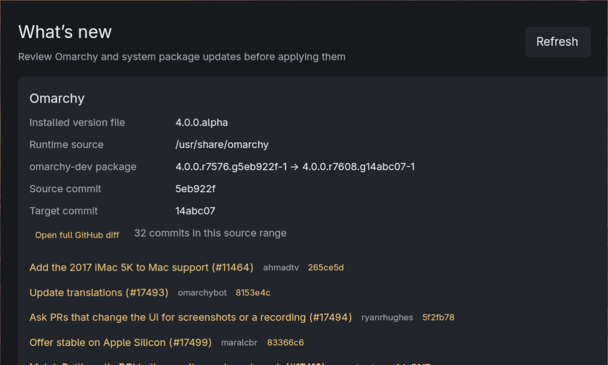

# What’s New

A small GPUI/Rust desktop preview of Omarchy and Arch package updates. Refresh reads the installed Omarchy version, runs `checkupdates` to list pending package version changes, and (when the Omarchy package version embeds source revisions) fetches the corresponding commit titles from GitHub. The update button opens the normal `omarchy-update` flow in Omarchy’s floating terminal; it does not bypass the usual confirmation.



## Build and run

```sh
cargo run
```

Requirements include Rust/Cargo, the GPUI Linux build dependencies, `pacman-contrib` (`checkupdates`), `pacman`, `curl`, and `xdg-utils`. The expected Omarchy runtime version file is `/usr/share/omarchy/version`; set `OMARCHY_PATH` to override its directory (useful for testing).

## Limitations

- Refresh is read-only with respect to package installation. `checkupdates` uses a temporary sync database; it does not install updates.
- Pacman metadata has no standard per-package changelog interface. Package rows therefore show old/new versions and a best-effort upstream URL, not guaranteed release notes.
- Omarchy source details are compared by commit IDs embedded in package versions. GitHub access is needed to display commit titles; the full compare URL remains clickable if that fetch fails.
- The update action depends on Omarchy’s `omarchy-launch-floating-terminal-with-presentation` helper being available in the user’s PATH.

The local `vendor-xattr` patch maps Linux’s missing-xattr error to `ENODATA`, working around an upstream transitive GPUI dependency that expects `ENOATTR` in libc.
